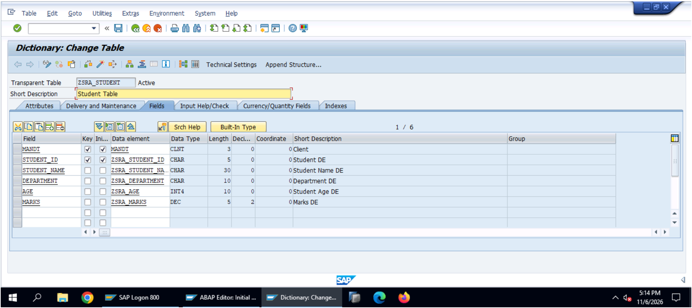
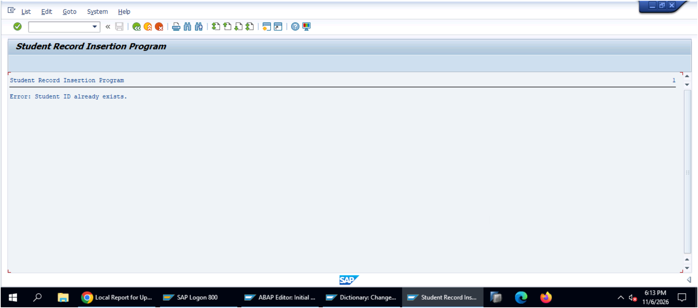
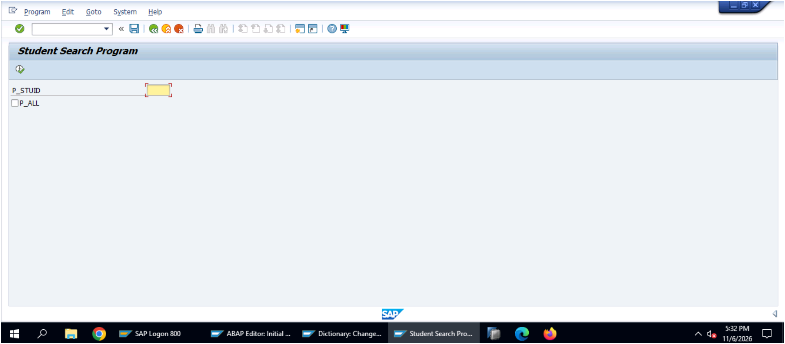
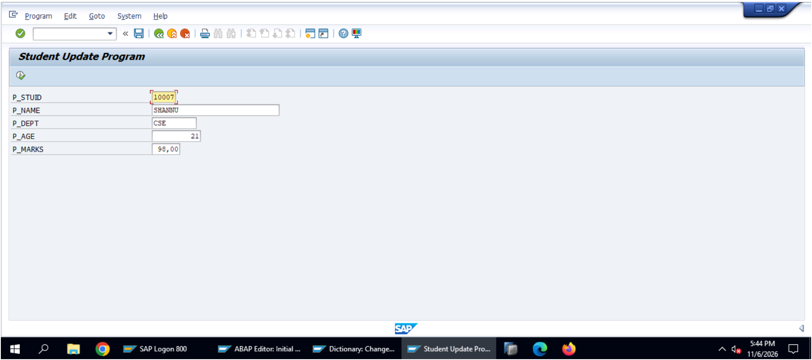
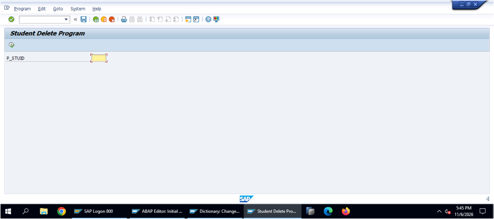
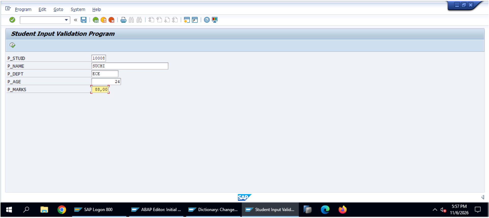
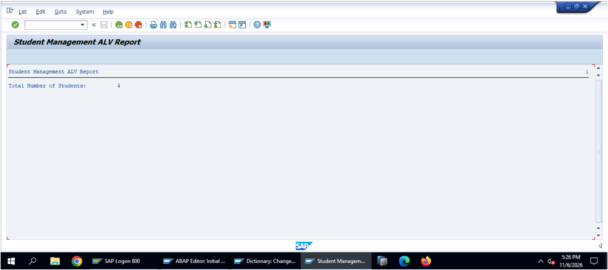
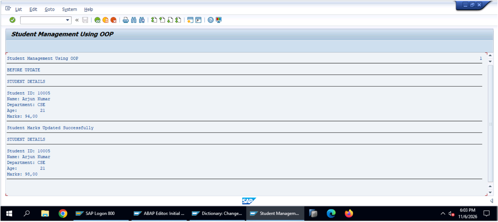

# SAP ABAP Student Management System

## Project Overview

The **SAP ABAP Student Management System** is a database-driven application developed using Core ABAP concepts. It manages student records through operations such as inserting, searching, updating, deleting, validating, and displaying student information.

The project demonstrates practical implementation of ABAP programming, Open SQL, Object-Oriented ABAP, modularization, and ALV reporting.

## Technologies Used

- SAP ABAP
- SAP GUI
- ABAP Dictionary (DDIC)
- Open SQL
- Object-Oriented ABAP (OOP)
- ALV Reports

## Key Features

1. **Student Database Management** – Created a custom database table to store student information.
2. **Insert Student Records** – Add new student details.
3. **Search Student Records** – Retrieve student information using Student ID.
4. **Update Student Records** – Modify existing student details.
5. **Delete Student Records** – Remove student records from the database.
6. **Data Validation** – Validate student information and marks.
7. **Modular Programming** – Implement reusable code using modularization.
8. **Object-Oriented Programming** – Demonstrate ABAP classes and methods.
9. **ALV Reporting** – Display student records in an ALV report.
10. **Student Count** – Calculate the total number of student records.

## Project Structure

| Program / File | Description |
|---|---|
| zsra_student_insert.abap | Insert student records |
| zsra_student_search.abap | Search student records |
| zsra_student_update.abap | Update student records |
| zsra_student_delete.abap | Delete student records |
| zsra_student_validate.abap | Validate student details |
| zsra_student_reusable_validate.abap | Reusable validation logic |
| zsra_student_modular.abap | Modular programming |
| zsra_student_oop.abap | Object-Oriented ABAP |
| zsra_student_alv.abap | ALV reporting |
| zsra_student_count.abap | Count student records |
| zsra_student_params.abap | Parameter handling |
| zsra_student_mgmt.abap | Student management program |

## Output Screenshots

The repository includes screenshots demonstrating the execution and testing of different modules.

### Database Table

### Insert Operation

### Search Operation

### Update Operation

### Delete Operation

### Validation

### ALV Report

### OOP Implementation

## Key ABAP Concepts Learned

- DATA and TYPES declarations
- PARAMETERS
- IF and CASE statements
- Internal tables and work areas
- Open SQL statements
- INSERT, SELECT, UPDATE and DELETE
- SY-SUBRC system field
- Modularization
- Classes and methods
- Exception handling
- ALV reporting

## Project Outcome

Successfully developed and tested a student management application using Core SAP ABAP concepts, demonstrating database operations, data validation, reusable programming, OOP concepts, and ALV reporting.

## Author

**Raghumanda Sravanthi**

B.Tech – Computer Science and Engineering

GitHub: [Shravs157-59](https://github.com/Shravs157-59)
